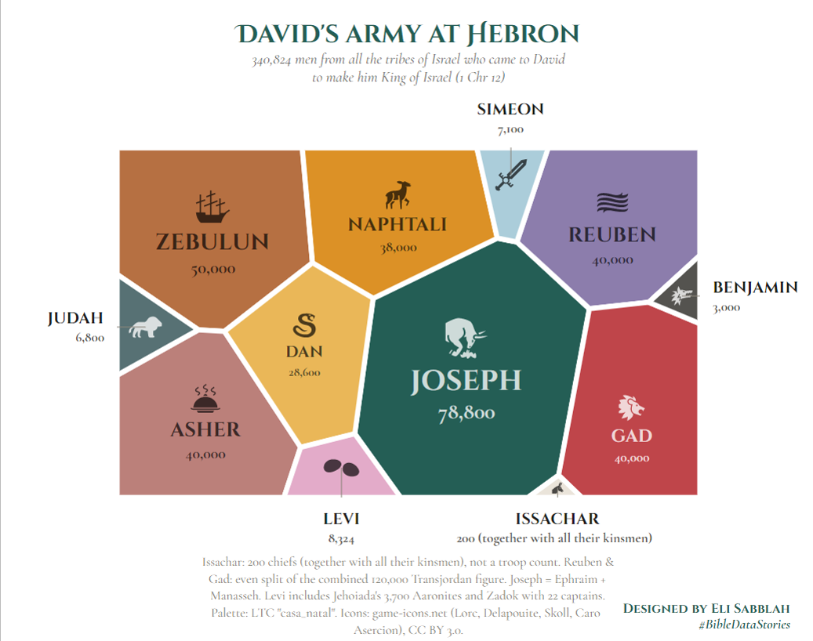

# David at Hebron: All Israel came to make David king

**340,824 men from all the tribes of Israel came to David to make him king (1 Chronicles 12:23-37).**



This is an interactive **Voronoi treemap** of the contingents each tribe sent to David at Hebron:

- **Cell area** is the number of men.
- **Cell colour** marks the tribe. The palette is LTC `casa_natal`, stretched to 12 colours.
- **Icons** are each tribe's traditional symbol (Genesis 49, Deuteronomy 33), drawn in a lighter or darker shade of the cell colour.
- **Hover** over a cell to see its count and any notes on how it was worked out.

Download [`david_at_hebron.html`](david_at_hebron.html) and open it in a browser to see the interactive version.

## The data

| Tribe | Men | Source | Note |
|---|---:|---|---|
| Joseph | 78,800 | 1 Chr 12:30, 31, 37 | Ephraim 20,800 + Manasseh (west) 18,000 + 40,000 east-Manasseh share |
| Zebulun | 50,000 | 1 Chr 12:33 | |
| Reuben | 40,000 | 1 Chr 12:37 | Even split of the combined 120,000 (assumption) |
| Gad | 40,000 | 1 Chr 12:37 | Even split of the combined 120,000 (assumption) |
| Asher | 40,000 | 1 Chr 12:36 | |
| Naphtali | 38,000 | 1 Chr 12:34 | 1,000 captains + 37,000 with them |
| Dan | 28,600 | 1 Chr 12:35 | |
| Levi | 8,324 | 1 Chr 12:26-28 | 4,600 Levites + Jehoiada & 3,700 Aaronites + Zadok & 22 captains |
| Simeon | 7,100 | 1 Chr 12:25 | |
| Judah | 6,800 | 1 Chr 12:24 | |
| Benjamin | 3,000 | 1 Chr 12:29 | |
| Issachar | 200 | 1 Chr 12:32 | 200 chiefs "with all their kinsmen", not a troop count |
| **Total** | **340,824** | | |

### How the numbers were reconciled

1. **Reuben, Gad and east Manasseh** appear in the text as one combined figure of 120,000 (v. 37). The chart splits it evenly at 40,000 each. The text gives no breakdown, so this split is an **assumption**.
2. **Ephraim and both halves of Manasseh** are merged into **Joseph**, so that exactly 12 tribes remain.
3. **Issachar's 200** are *chiefs* (v. 32). The chart shows that number as given and does not estimate the kinsmen with them.
4. **Levi** includes the priestly line: 4,600 Levites (v. 26), Jehoiada with 3,700 Aaronites (v. 27), and Zadok with 22 captains (v. 28). Each named leader counts as one man.
5. **Naphtali** is 1,000 captains plus 37,000 men with them (v. 34).

## Files

| File | What it is |
|---|---|
| `david_at_hebron.R` | Script that builds the chart |
| `david_at_hebron_data.csv` | Tidy table of tribe, men, verse and notes (the table above) |
| `David at Hebron.xlsx` | Working spreadsheet: tribal symbols, their biblical sources and the raw counts from 1 Chr 12 |
| `tribe_icons.csv` | Icon outlines as polygon coordinates (`tribe, sub, x, y`) |
| `david_at_hebron.html` | Self-contained interactive chart |
| `david_at_hebron.png` | Static image of the chart |

## Reproduce it

```r
install.packages(c("remotes", "readxl", "dplyr", "ggplot2", "ggiraph",
                   "htmlwidgets", "ggtext", "systemfonts", "jsonlite"))
remotes::install_github("loukesio/ggvmap")
remotes::install_github("loukesio/ltc-color-palettes")   # package name: ltc

setwd("path/to/Bible-Data-Stories/david-at-hebron")
source("david_at_hebron.R")
```

On its first run the script downloads the Google Fonts it uses (Cinzel Decorative, Cinzel and Cormorant Garamond) into a `fonts/` folder, so it needs an internet connection. It then writes `david_at_hebron.html`. To try another layout, change `SEED`. To try another LTC palette, change `LTC_PALETTE`.

## Credits

- **Design:** Eli Sabblah, `#BibleDataStories`
- **Voronoi treemap:** [ggvmap](https://github.com/loukesio/ggvmap). **Palette:** [LTC colour palettes](https://github.com/loukesio/ltc-color-palettes)
- **Icons:** [game-icons.net](https://game-icons.net) by Lorc, Delapouite, Skoll and Caro Asercion, [CC BY 3.0](https://creativecommons.org/licenses/by/3.0/). Judah's lioness is from Pinhead Map Icons (Quincy Morgan), CC0. Levi's two stones (Urim & Thummim) were drawn for this chart.
- **Text:** 1 Chronicles 12:23-37
